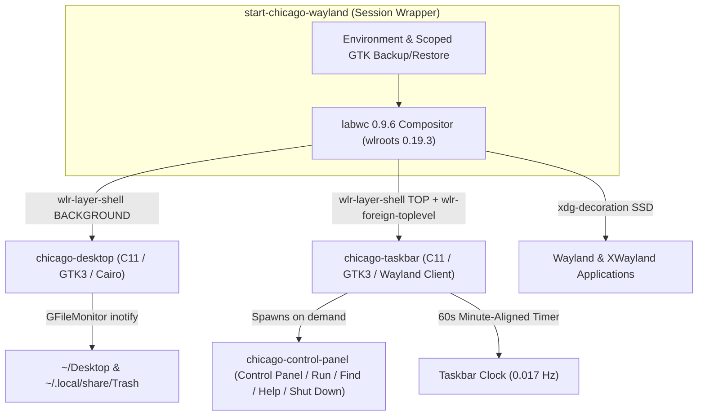

# Architecture & Engineering Design

## 1. Compositor Evaluation & Selection

Before implementing **Chicago-Wayland**, we evaluated candidate Wayland compositors against the project's visual, protocol, compatibility, and idle-power requirements on Fedora Linux 44:

| Criterion | **Labwc (0.9.6)** | **Sway (1.10+)** | **Wayfire** | **Weston** | **Custom wlroots Compositor** |
| :--- | :--- | :--- | :--- | :--- | :--- |
| **Window Paradigm** | Floating / Stacking (Win95 native) | Tiling-first (floating secondary) | 3D Compiz-style effects | Reference / kiosk shell | Arbitrary |
| **Server-Side Decorations (SSD)** | Openbox-3 `themerc` + PNG/XBM titlebar buttons | Basic 1-color titlebar, no button icons | Pixdecor plugin (heavy) | Minimal reference | Requires full scene-graph implementation |
| **Square Corners & 3D Bevels** | Native (`<cornerRadius>0</cornerRadius>`) | Native | Plugin-dependent | Limited | Manual Cairo/GLES2 |
| **Wayland Protocols** | `xdg-shell`, `wlr-layer-shell`, `wlr-foreign-toplevel`, `wlr-output-management`, `ext-idle-notify`, `xdg-decoration` | Same (`wlroots`) | Same (`wlroots`) | Core Wayland only (no `wlr-*`) | High maintenance burden |
| **Idle CPU & Wakeups** | ~0.00% CPU, 0 wakeups/s when static | ~0.00% CPU | Higher GPU overhead | Low | Depends on implementation |
| **Memory Footprint (PSS)** | ~53.8 MiB | ~48 MiB | ~110 MiB | ~35 MiB | ~45 MiB |
| **Fedora 44 Packaging** | Official `fedora` repo (`0.9.6-1.fc44`) | Official `fedora` repo | Official `fedora` repo | Official `fedora` repo | Unpackaged |

### Decision: Labwc 0.9.6 (`wlroots 0.19.3`)
`labwc` is selected as the compositor foundation because:
1. It is a native `wlroots` stacking compositor with damage-tracked rendering (zero GPU redraws when screen contents are static).
2. It natively implements `xdg-decoration-unstable-v1` server-side decorations with full Openbox-3 theme syntax (`themerc`), left-aligned window icon + title, and custom 14×13 pixel button PNGs.
3. Writing a custom compositor from scratch would duplicate tens of thousands of lines of `xdg-shell`, `Xwayland`, `libinput`, DRM atomic modesetting, and `wlr-layer-shell` state machines without improving idle power.

---

## 2. Taskbar & Panel Evaluation (`chicago-taskbar` vs `sfwbar` vs `Waybar`)

| Feature / Metric | **`chicago-taskbar` (Custom C11)** | **`sfwbar` (1.0-beta16)** | **`Waybar` (0.15.0)** |
| :--- | :--- | :--- | :--- |
| **Binary Size** | **59 KB** | 16 KB + ~300 KB plugins | ~2.4 MB (C++ / fmt / spdlog / gtkmm3) |
| **Idle CPU / Wakeups** | **0.00% CPU / 0.017 wakeups/s** (60s minute clock alignment) | **0.00% CPU / 0.10 wakeups/s** (with 60s clock config) | Higher wakeup rate if polling modules enabled |
| **Unique Memory (PSS)** | **~14.8 MiB** | **~16.0 MiB** | ~28–40 MiB |
| **Win95 Start Menu Banner** | **Native rotated "Windows 95" vertical sidebar** | Standard GTK popup menu only | Requires external launcher (`wofi`/`fuzzel`) |
| **Win95 Sunken/Raised Task Buttons** | **Exact 2px 3D bevel + dithered active well** | Approximate CSS styling | Approximate CSS styling |
| **Window Management Protocol** | Native `zwlr_foreign_toplevel_manager_v1` | Native `zwlr_foreign_toplevel_manager_v1` | Native `zwlr_foreign_toplevel_manager_v1` |

### Decision
We built **`chicago-taskbar`** in C11 (`src/custom-components/src/chicago_taskbar.c`) as the primary taskbar, Start menu, and system tray implementation for maximum Windows 95 visual/behavioral accuracy and minimal wakeups, while also shipping a complete, zero-polling **`sfwbar`** configuration (`config/panel/chicago95.sfwbar`) selectable via `CHICAGO_PANEL=sfwbar`.

---

## 3. Component Architecture Diagram

---

## 4. Event-Driven Power Design (Zero Polling)

To meet or beat the 7 W idle baseline on the Dell Precision 5550 (Intel Core i7-10750H):
- **No polling scripts**: Neither `chicago-desktop` nor `chicago-taskbar` spawns periodic shell scripts (`grep`, `awk`, `ps`, `upower` loops).
- **Window state changes**: Driven purely by Wayland socket events (`zwlr_foreign_toplevel_handle_v1` listener callbacks).
- **Desktop & Start Menu file changes**: Driven by kernel `inotify` via GIO's `GFileMonitor` on `~/Desktop` and `~/.local/share/Trash/files`.
- **Clock updates**: Computes `60 - localtime(&now)->tm_sec` and schedules a single `g_timeout_add_seconds()` timer for the exact start of the next minute (1 wakeup per 60 seconds).
- **On-demand XWayland**: `<xwaylandPersistence>no</xwaylandPersistence>` in `rc.xml` keeps XWayland stopped until an X11 client actually connects, saving ~108 MiB RSS (~43 MiB PSS).
- **Zero visual effects**: `<dropShadows>no</dropShadows>`, `<cornerRadius>0</cornerRadius>`, `gtk-enable-animations = 0`, and `cursor_blink_interval 0` in Kitty prevent background GPU/CPU frame composite wakeups.
